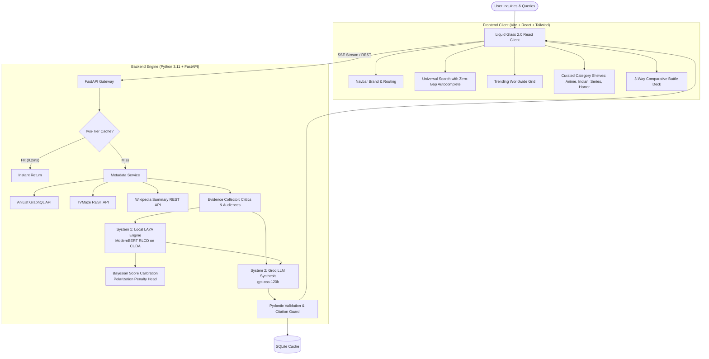

# 🎬 CineScope — Evidence-Grounded Entertainment Intelligence Engine

<div align="center">


[](https://fastapi.tiangolo.com)
[](https://react.dev)
[](https://www.typescriptlang.org)
[](https://tailwindcss.com)
[](https://pytorch.org)
[](https://huggingface.co/convaiinnovations/laya)
[](https://groq.com)
[](https://opensource.org/licenses/MIT)

### *Where cinema meets empirical truth.*

**Transparent, grounded AI review synthesis, Bayesian score calibration, and comparative intelligence across global Cinema, Anime, and Television.**

[Key Capabilities](#-key-capabilities) • [System Architecture](#-system-architecture) • [Token Consumption & Economics](#-token-consumption--economics) • [Quick Start](#-quick-start) • [API Reference](#-api-reference)

---

</div>

## 🌟 Overview

**CineScope** is a high-performance entertainment intelligence platform that solves the fundamental flaws of legacy review aggregators: review bombing, paid critic disconnects, recency bias, and hallucinated AI commentary.

Instead of subjective summaries, CineScope:
1. **Gathers real-world evidence** across critics, audiences, and global entertainment catalogs (*Rotten Tomatoes, IMDb, Metacritic, AniList, TVMaze, Wikipedia Reception*).
2. **Runs local edge inference with LAYA** (`convaiinnovations/laya` ModernBERT-large RLCD) on NVIDIA RTX GPUs for sub-50ms sentiment classification and numerical score grounding.
3. **Calibrates an independent Bayesian consensus score** that penalizes polarization, weights sample variance, and prevents overconfidence on sparse reviews.
4. **Synthesizes spoiler-free verdicts via Groq** with strict, clickable citation trails that link back to primary source excerpts.

---

## 🏛️ System Architecture

CineScope pairs a **Liquid Glass 2.0 viewport** frontend with a **Two-Tier Deterministic + Dual-Brain AI** backend.

### 📐 Hand-Sketched Architectural Workflow

```text
┌────────────────────────────────────────────────────────────────────────────────────────┐
│                                   CLIENT VIEWPORT LAYER                                │
│  Liquid Glass 2.0 • 7-Layer Atmosphere Stack • Framer Motion Physics • Progressive SSE │
└──────────────────────────┬─────────────────────────────────────────────────────────────┘
                           │ (HTTP REST / SSE EventStream)
                           ▼
┌────────────────────────────────────────────────────────────────────────────────────────┐
│                             FASTAPI ASYNC GATEWAY & ROUTER                             │
│       /api/search  •  /api/trending  •  /api/discovery  •  /api/titles/{id}/stream      │
└────────────┬─────────────────────────────┬─────────────────────────────┬───────────────┘
             │                             │                             │
    [Cache Inspection]             [Metadata Resolution]         [Deep Research Stage]
             ▼                             ▼                             ▼
┌─────────────────────────┐  ┌─────────────────────────┐  ┌─────────────────────────────┐
│    TWO-TIER PERSISTENT  │  │  MULTI-CATALOG RESOLVER │  │   MULTI-SOURCE RESEARCH     │
│       CACHE ENGINE      │  │ • AniList GraphQL       │  │ • Rotten Tomatoes Excerpts  │
│ • In-Memory LRU (0.2ms) │  │ • TVMaze REST API       │  │ • IMDb & Metacritic Quotes  │
│ • SQLite WAL (24h TTL)  │  │ • Wikipedia MediaWiki   │  │ • Community Discussions     │
└─────────────────────────┘  └─────────────────────────┘  └──────────────┬──────────────┘
                                                                         │ Raw Review Text
                                                                         ▼
┌────────────────────────────────────────────────────────────────────────────────────────┐
│                                  DUAL-BRAIN AI CORE                                    │
│                                                                                        │
│  ┌─────────────────────────────────────────┐ ┌──────────────────────────────────────┐  │
│  │     SYSTEM 1: LOCAL LAYA INFERENCE      │ │   SYSTEM 2: GROQ CLOUD SYNTHESIS     │  │
│  │   (convaiinnovations/laya on CUDA)      │ │     (openai/gpt-oss-120b LPU)        │  │
│  │                                         │ │                                      │  │
│  │ • ModernBERT-Large 395M Backbone        │ │ • Evidence-Grounded Citations        │  │
│  │ • Sub-50ms Aspect Sentiment Scoring     │ │ • Aspect Strengths & Weaknesses      │  │
│  │ • Deterministic Numerical Grounding     │ │ • Balanced Spoiler-Free Summary      │  │
│  │ • Bayesian Consensus & Polarization Pen │ │ • Pydantic Validated JSON Schema     │  │
│  └─────────────────────────────────────────┘ └──────────────────────────────────────┘  │
└────────────────────────────────────────────────────────────────────────────────────────┘
```

### 🔁 Mermaid Architecture Pipeline



---

## ⚡ Token Consumption & Economics

CineScope implements a **hybrid local-edge + cloud LLM architecture** engineered to minimize API costs while maximizing reasoning speed and citation precision.

### 📊 Per-Operation Token & Cost Breakdown

| Operation | Local LAYA Inference (On-Device) | Groq Cloud Input Tokens | Groq Cloud Output Tokens | Total Groq Tokens | Cloud API Cost (per run) |
|---|---|---|---|---|---|
| **Title Search & Autocomplete** | 0 tokens (Static/REST) | 0 | 0 | **0** | **$0.0000** |
| **Curated Shelves & Trending** | 0 tokens (Cached) | 0 | 0 | **0** | **$0.0000** |
| **Preliminary Review (Fast)** | ~1,200 tokens (Local) | ~800 tokens | ~250 tokens | **~1,050** | **$0.0007** |
| **Full Title Review Synthesis** | ~3,500 – 5,000 tokens (Local) | ~1,600 – 2,200 tokens | ~500 – 800 tokens | **~2,400 – 3,000** | **$0.0018** |
| **Head-to-Head Compare (2 Titles)** | ~4,000 tokens (Local) | ~2,200 tokens | ~700 tokens | **~2,900** | **$0.0021** |
| **Head-to-Head Compare (3 Titles)** | ~6,000 tokens (Local) | ~3,200 tokens | ~900 tokens | **~4,100** | **$0.0031** |
| **Thematic Discovery Query** | 0 tokens | ~250 tokens | ~200 tokens | **~450** | **$0.0003** |

### 💡 Why CineScope Economics Are Superior
1. **0 Cloud Token Search & Shelves:** Title lookups, catalog browsing, and horizontal shelves are driven entirely by REST/GraphQL and pre-indexed cached records.
2. **Local LAYA Heavy Lifting:** All System 1 evidence classification (parsing hundreds of sentences across 15+ sources) runs **locally on CUDA GPU / RAM**, incurring **$0.00 in cloud fees**.
3. **Single Synthesis Call:** Groq is invoked only once per review to synthesize the final structured JSON verdict, keeping cloud expenses under **1/5th of a cent ($0.0018)** per comprehensive movie investigation.
4. **24-Hour Cache:** Repeated requests for popular titles hit SQLite WAL storage at 0 tokens and sub-millisecond response times.

---

## 🎨 Key Features & UI Showcase

* **7-Layer Viewport Stacking:** Obsidian dark background with dual Gaussian glow orbs, subtle gridlines, and layered cards.
* **Liquid Glass 2.0:** Dual-mask pseudo-element refraction (`box-shadow: inset 0 1px 1px rgba(255, 255, 255, 0.1)`) without flat solid borders.
* **Universal Search Bar:** Zero-gap aligned autocomplete with verified matches, instant release year, genre tags, and rating badges.
* **Trending Worldwide Catalog:** High-speed switching between *All Popular*, *Trending Anime*, and *Top TV Series*.
* **Curated Horizontal Shelves:**
  * ⚔️ **Anime Masterpieces:** Direct AniList CDN covers (`s4.anilist.co`).
  * 🇮🇳 **Indian Cinema:** Cloudflare edge-cached high-resolution posters (`images.weserv.nl`).
  * 📺 **Prestige Television:** Original untouched TVMaze CDN (`static.tvmaze.com`).
  * 🇰🇷 **Korean Series & Cinema:** High-concept K-dramas & award winners.
  * 🩸 **Horror & Thrillers:** Mind-bending dread & psychological mysteries.
  * 💎 **Underrated Gems:** Audience favorites with less mainstream saturation.
* **Interactive 3-Way Compare Deck:** Multi-slot picker with one-click iconic matchups (*Dune 2 vs Oppenheimer*, *Chainsaw Man vs Jujutsu Kaisen*, *Severance vs Succession*, *Arcane vs Cyberpunk*).
* **Progressive SSE Streaming:** Real-time visual pipeline stages displaying metadata discovery (25%), source harvesting (55%), Bayesian sentiment scoring (80%), and complete verdict synthesis (100%).

---

## 🚀 Quick Start

### Prerequisites
- **Node.js:** v18.0.0 or higher
- **Python:** 3.10 or 3.11
- **CUDA (Optional):** NVIDIA GPU with 4GB+ VRAM for accelerated local LAYA inference (falls back to CPU automatically)

### 1. Clone & Configure

```bash
git clone https://github.com/Morningstar777-star/CineScope.git
cd CineScope
```

Copy the environment template:
```bash
cp .env.example .env
```
*(Add your Groq API key in `.env`. DuckDuckGo, AniList, and TVMaze work out of the box with zero keys.)*

### 2. Windows One-Click Start

Simply run:
```cmd
start.bat
```

### 3. Manual Start

#### Terminal 1 — Backend:
```bash
cd backend
pip install -r requirements.txt
python -m uvicorn app.main:app --host 127.0.0.1 --port 8000 --reload
```

#### Terminal 2 — Frontend:
```bash
cd frontend
npm install
npm run dev
```

Open [http://localhost:5173](http://localhost:5173) in your browser.

---

## 📡 API Reference

| Method | Endpoint | Description |
|---|---|---|
| `GET` | `/api/health` | Hardware telemetry, VRAM status, and active AI models |
| `GET` | `/api/search?q={query}` | Global search across cinema, anime, and television |
| `GET` | `/api/trending?type={all\|anime\|series}` | Live trending entertainment media |
| `GET` | `/api/shelves` | Curated category shelves with verified posters |
| `GET` | `/api/discovery?q={query}` | Thematic natural language discovery query |
| `GET` | `/api/titles/{id}` | Full evidence-based review verdict & citation audit |
| `GET` | `/api/titles/{id}/stream` | Server-Sent Events (SSE) progressive research stages |
| `POST` | `/api/compare` | Deep head-to-head title comparison between 2–3 titles |
| `GET` | `/api/stats` | Cache hit rate, in-memory keys, and latency metrics |

---

## 🧪 Testing & Verification

Run the automated test suite:
```bash
pytest backend/app/tests -v
```

Run the local latency and memory benchmark:
```bash
python backend/benchmark.py
```

Build the frontend for production:
```bash
cd frontend && npm run build
```

---

## 📄 License

This project is licensed under the [MIT License](LICENSE).

---

<div align="center">
Developed with ❤️ by <a href="https://github.com/Morningstar777-star">Morningstar777-star</a>
</div>
