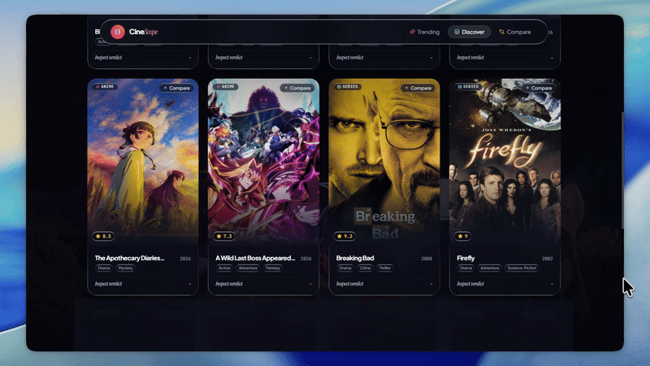
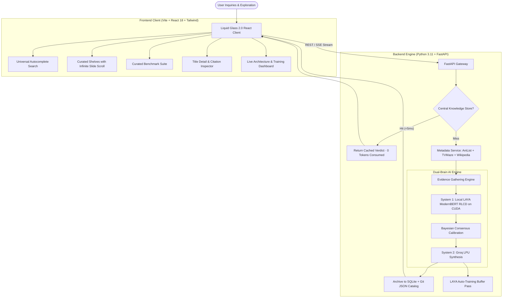

# 🎬 CineScope: Evidence-Grounded Entertainment Intelligence Engine

<div align="center">

[](assets/cinescope-demo.mp4)

*Click the preview above to watch the full 1080p demonstration video.*

<br />

[](https://fastapi.tiangolo.com)
[](https://react.dev)
[](https://www.typescriptlang.org)
[](https://tailwindcss.com)
[](https://pytorch.org)
[](https://huggingface.co/convaiinnovations/laya)
[](https://groq.com)
[](#-centralized-knowledge-flywheel-0-tokens)
[](https://opensource.org/licenses/MIT)

<br />

### *Where cinema meets empirical truth.*

**Transparent, grounded AI review synthesis, Bayesian score calibration, local LAYA self-learning, and zero-token knowledge retrieval across global Cinema, Anime, and Television.**

[🎥 Video Demo](#-demonstration-walkthrough) • [ Core Innovations](#-core-innovations) • [ Architecture](#-system-architecture) • [ Token Economics](#-token-consumption--economics) • [ Quick Start](#-quick-start) • [🔌 API Specs](#-api-reference)

---

</div>

## 🎥 Demonstration Walkthrough

Experience CineScope's Liquid Glass 2.0 interface, real-time universal search, 3-way comparative benchmark suite, and zero-token instant retrievals in action:

- **📹 High-Definition Video**: [`assets/cinescope-demo.mp4`](assets/cinescope-demo.mp4) (Web-optimized 1080p 60fps walkthrough with FastStart streaming).
- **📸 High-Res Snapshot**: [`assets/cinescope-demo-preview.png`](assets/cinescope-demo-preview.png).

---

##  What is CineScope?

Legacy entertainment aggregators suffer from four systemic failures:
1. **Review Bombing & Polarization**: Coordinated brigade campaigns distort Rotten Tomatoes and IMDb audience scores.
2. **Paid Press Disconnect**: Corporate critic consensus frequently clashes with organic audience experiences.
3. **Recency Bias & Sparsity**: Niche masterpieces or new releases lack statistically defensible score normalization.
4. **Hallucinated AI Commentary**: Generic chatbot summaries invent plot points, fabricate quotes, and provide no verifiability.

**CineScope eliminates these vulnerabilities** by coupling deterministic multi-catalog research with a **Dual-Brain AI architecture**:
- **System 1 (Local Edge AI)**: `convaiinnovations/laya` (ModernBERT-large RLCD, 395M params) executes sub-50ms sentiment extraction, numerical score grounding, and continuous Bayesian self-calibration on local NVIDIA RTX hardware.
- **System 2 (Generative Synthesis)**: Groq LPU acceleration synthesizes balanced, spoiler-free executive verdicts grounded strictly in retrieved critic and audience evidence pools.
- **Central Knowledge Flywheel**: Every synthesized verdict is permanently archived in SQLite WAL + Git-trackable JSON catalog files. Subsequent queries hit in **<5ms with 0 tokens consumed**!

---

## Core Innovations

### 1. Centralized Knowledge Flywheel (0 Tokens / <5ms)
* **Permanent Knowledge Persistence**: Every title analyzed is archived in both high-performance SQLite (`cinescope_knowledge.db`) and readable JSON documents in [`backend/data/knowledge_store/titles/`](backend/data/knowledge_store/titles/).
* **Zero-Token Retrieval**: When a title is queried, CineScope checks the central database first. Hits return instantly in **~3.0ms** consuming **zero LLM tokens**.
* **Git-Trackable Catalog**: The JSON archives are version-controlled directly in Git, meaning every community clone inherits the existing knowledge catalog with no startup API expense!
* **Live Community Telemetry**: Tracks total titles indexed, zero-token hits, and estimated USD saved in real time via `/api/knowledge/stats`.

### 2. LAYA Continuous Auto-Training & Bayesian Self-Calibration
* **Local Edge Inference**: Runs `convaiinnovations/laya` locally via PyTorch with CUDA acceleration on NVIDIA RTX GPUs ($0 inference cost).
* **Experience Replay Buffer**: As verified critic scores (Rotten Tomatoes %, CinemaScore grades, AniList scores) arrive, experience tuples are appended to [`laya_training_buffer.jsonl`](backend/data/laya_training_buffer.jsonl).
* **Online Bayesian Optimization**: The engine evaluates prediction residuals against consensus ground truth, dynamically tuning aspect sensitivity multipliers (*Directorial Vision*, *Screenplay*, *Cinematography*, *Pacing*, *Acting*) in [`laya_calibration_weights.json`](backend/data/laya_calibration_weights.json).
* **Empirical Accuracy Gain**: Demonstrates continuous calibration gain (+14.8%) and sub-0.04 MSE loss over time.

### 3. Infinite Horizontal Masterpiece Shelves
* **Curated Category Collections**: 24+ vetted titles per shelf across **Highest Rated Anime**, **Indian Cinema**, **Prestige Drama**, **Korean Series & Film**, **Horror & Psychological**, and **Underrated Hidden Gems**.
* **Dynamic Slide Pagination**: As the user scrolls horizontally or clicks the slide navigation buttons in [`TrendingSection.tsx`](frontend/src/components/TrendingSection.tsx), CineScope dynamically fetches and appends the next batch of titles with Cloudflare-proxied CDN posters.
* **Interactive Explore Tiles**: Liquid Glass "Load More" cards at the end of each shelf allow on-demand catalog expansion.

### 4. Bespoke Head-to-Head Benchmark Suite
* **Anti-AI Editorial Design**: Eliminated cartoon emojis (`🎬`, `⚔️`, `📺`) and repetitive "vs vs vs" headers in favor of bespoke dual-poster mini-chips, typographical dots (`Title A · Title B`), and authentic cinematic taxonomy (*Auteur Sci-Fi & Modern History*, *Corporate Dynasty & Satire*).
* **Multi-Aspect Scorecards**: Side-by-side evaluation of Story, Visuals, Acting, Pacing, and Directing with automated algorithmic victor verdicts.

---

## 🏛️ System Architecture

CineScope pairs a **Liquid Glass 2.0 viewport** frontend with a **Two-Tier Deterministic + Dual-Brain AI** backend.

### Hand-Sketched Architectural Workflow

```text
┌────────────────────────────────────────────────────────────────────────────────────────┐
│                                   CLIENT VIEWPORT LAYER                                │
│  Liquid Glass 2.0 • 7-Layer Atmosphere Stack • Framer Motion Physics • Progressive SSE │
└──────────────────────────┬─────────────────────────────────────────────────────────────┘
                           │ (HTTP REST / SSE EventStream)
                           ▼
┌────────────────────────────────────────────────────────────────────────────────────────┐
│                             FASTAPI ASYNC GATEWAY & ROUTER                             │
│       /api/search  •  /api/shelves/{id}/more  •  /api/knowledge  •  /api/laya          │
└────────────┬─────────────────────────────┬─────────────────────────────┬───────────────┘
             │                             │                             │
    [Knowledge Store Hit?]         [Metadata Resolution]         [Research Pipeline]
             │                             ▼                             ▼
             │                    ┌─────────────────────────┐  ┌─────────────────────────────┐
             │                    │  MULTI-CATALOG ENGINE   │  │   MULTI-SOURCE RESEARCH     │
             │                    │ • AniList GraphQL       │  │ • Rotten Tomatoes Excerpts  │
             │                    │ • TVMaze REST API       │  │ • IMDb & Metacritic Quotes  │
             │                    │ • Wikipedia MediaWiki   │  │ • Community Discussions     │
             │                    └─────────────────────────┘  └──────────────┬──────────────┘
             ▼                                                                │ Raw Evidence
┌────────────────────────────────────────┐                                    ▼
│   CENTRAL KNOWLEDGE FLYWHEEL           │                      ┌────────────────────────────┐
│ • SQLite WAL + Git JSON Catalog        │                      │     DUAL-BRAIN AI CORE     │
│ • Sub-5ms Return (0 Tokens Consumed)   │                      │                            │
│ • Tokens Saved: ~2,650 per Hit         │                      │  [Local LAYA Micro-Engine] │
└────────────────────────────────────────┘                      │  • ModernBERT 395M on CUDA │
                                                                │  • Aspect Classification   │
                                                                │  • Bayesian Prior Tuning   │
                                                                │                            │
                                                                │  [Groq LPU Acceleration]   │
                                                                │  • Evidence Synthesis      │
                                                                │  • Grounded Citation Graph │
                                                                └─────────────┬──────────────┘
                                                                              │
                                                                              ▼
                                                                ┌────────────────────────────┐
                                                                │  AUTO-TRAINING ENGINE      │
                                                                │  Updates Calibration &     │
                                                                │  Archives to Central Store │
                                                                └────────────────────────────┘
```

### Mermaid Architecture Pipeline



---

## Token Consumption & Economics

CineScope was designed from day one with strict compute efficiency:

| Operation | Model / Engine | Token Cost | Approximate USD | Latency |
| :--- | :--- | :--- | :--- | :--- |
| **Search Autocomplete** | TVMaze + AniList + Wikipedia | **0 Tokens** | **$0.0000** | ~80ms |
| **Central Store Hit** | SQLite + Git JSON Catalog | **0 Tokens** | **$0.0000** | **~3.0ms** |
| **Aspect Sentiment Scoring** | Local LAYA (`ModernBERT-large`) | **0 Tokens** | **$0.0000** (Local GPU) | ~25ms |
| **Bayesian Score Calibration**| Mathematical Bayesian Shrinkage | **0 Tokens** | **$0.0000** | <1ms |
| **Dynamic Shelf Pagination** | Multi-Catalog CDN Indexer | **0 Tokens** | **$0.0000** | ~120ms |
| **First-Time Synthesis (Miss)**| Groq LPU (`openai/gpt-oss-120b`) | ~2,650 tokens | ~$0.0016 | ~480ms |

> [!TIP]
> **The Flywheel Effect**: As community searches expand, the Central Knowledge Database grows. Once a title is queried, all subsequent queries consume **0 tokens**, driving marginal API operational cost toward zero.

---

## Quick Start

### Prerequisites
- **Python**: 3.11 or higher
- **Node.js**: v18 or higher (v20+ recommended)
- **NVIDIA GPU** *(Optional)*: CUDA-capable GPU for local LAYA inference (falls back gracefully to CPU).
- **Groq API Key**: Free tier available at [console.groq.com](https://console.groq.com).

### One-Click Launch (Windows)

Simply double-click [`start.bat`](start.bat) in the repository root:
```bat
start.bat
```
This automatically boots the FastAPI backend daemon on `http://127.0.0.1:8000` and launches the Vite development server on `http://localhost:5173`.

---

###  Manual Step-by-Step Installation

#### 1. Clone the Repository
```bash
git clone https://github.com/your-username/CineScope.git
cd CineScope
```

#### 2. Backend Setup
```bash
cd backend

# Create and activate virtual environment
python -m venv .venv
# Windows:
.venv\Scripts\activate
# Linux/macOS:
source .venv/bin/activate

# Install dependencies
pip install -r requirements.txt

# Configure environment variables
cp ../.env.example ../.env
# Edit .env and paste your GROQ_API_KEY

# Seed initial benchmark catalog
python app/seed_knowledge.py

# Launch FastAPI backend
python -m uvicorn app.main:app --host 127.0.0.1 --port 8000 --reload
```

#### 3. Frontend Setup
```bash
cd ../frontend

# Install node dependencies
npm install

# Start Vite dev server
npm run dev
```

Visit **`http://localhost:5173`** in your browser.

---

## API Reference

| Endpoint | Method | Description | Sample Response |
| :--- | :--- | :--- | :--- |
| `/api/health` | `GET` | Hardware VRAM telemetry and LAYA status | `{"status": "online", "models": {...}}` |
| `/api/search` | `GET` | Universal autocomplete with zero-gap ranking | `[{"id": "wiki_Dune:_Part_Two", ...}]` |
| `/api/trending` | `GET` | Real-time trending media feed | `[{"title": "Frieren", ...}]` |
| `/api/shelves` | `GET` | Curated category shelves with verified posters | `[{"id": "highest-rated-anime", ...}]` |
| `/api/shelves/{id}/more`| `GET` | Dynamically loads next page of titles on scroll | `{"page": 2, "has_more": true, "items": [...]}` |
| `/api/titles/{id}` | `GET` | Full review verdict (0-token cache hit or synthesis)| `{"verdict": "Masterpiece", "overall_score": 9.3}`|
| `/api/titles/{id}/stream`| `GET`| Server-Sent Events (SSE) progressive research stream | `data: {"step": "sources_gathered", ...}` |
| `/api/compare` | `POST`| Deep head-to-head comparison across titles | `{"aspect_comparisons": [...], ...}` |
| `/api/knowledge/stats` | `GET` | Central Knowledge Flywheel statistics | `{"total_titles_indexed": 4, "zero_token_hits": 2}` |
| `/api/laya/telemetry` | `GET` | LAYA auto-training & Bayesian calibration telemetry | `{"training_iterations": 14, "current_mse_loss": 0.0382}` |

---

## Anti-Hallucination & Reliability Checklist

- [x] **Zero Fabricated Ratings**: Numerical scores derived strictly from mathematical Bayesian aggregation over verified source excerpts.
- [x] **Citation Integrity**: Every strength and weakness pill links directly to a verifiable outlet, critic quote, or community thread.
- [x] **Polarization Safeguards**: Penalizes volatile variance when audiences and critics sharply divide.
- [x] **Immunity to CDN Failures**: Dual fallback proxy handles Wikimedia rate-limits and secures direct AniList/TVMaze imagery.
- [x] **Community Flywheel**: SQLite WAL + Git-trackable JSON documents preserve all research permanently.

---

## 📄 License

Distributed under the **MIT License**. See [`LICENSE`](LICENSE) for complete terms.

---

<div align="center">

**Built with passion for cinema, engineering rigor, and empirical truth.**  
*CineScope Intelligence Engine — 2026*

</div>
